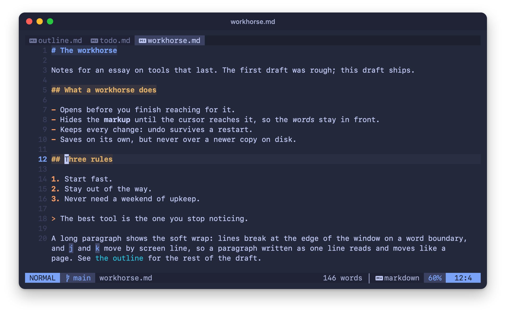
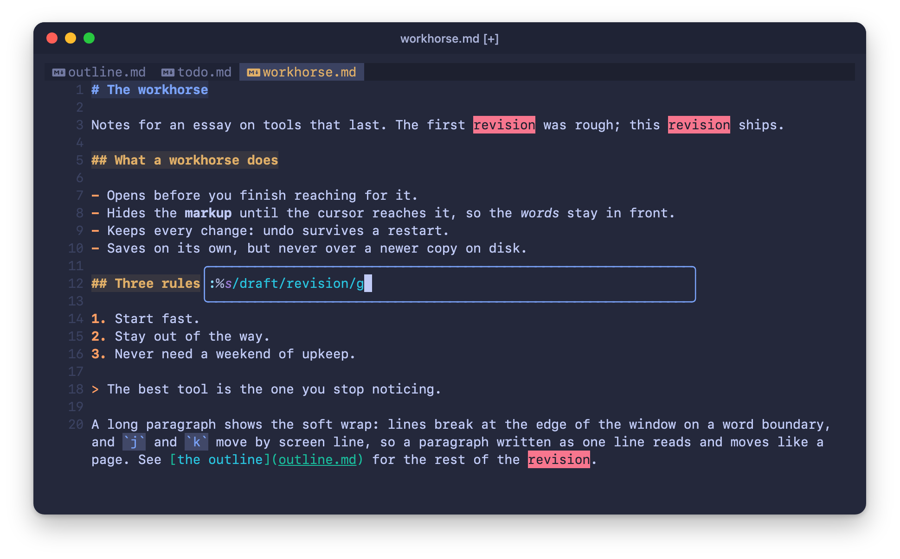
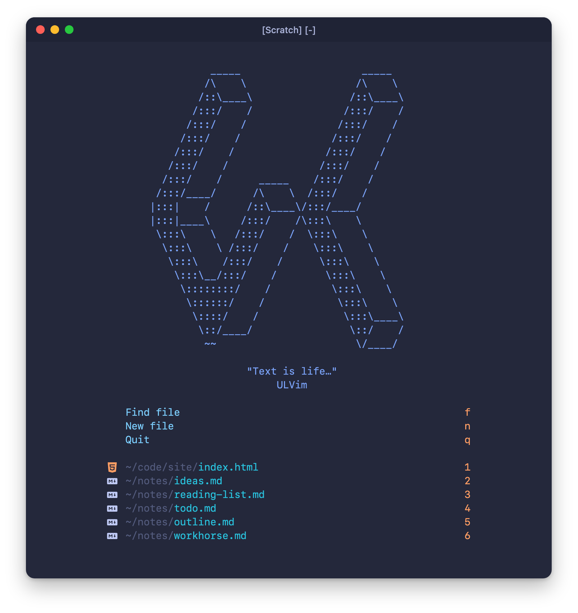
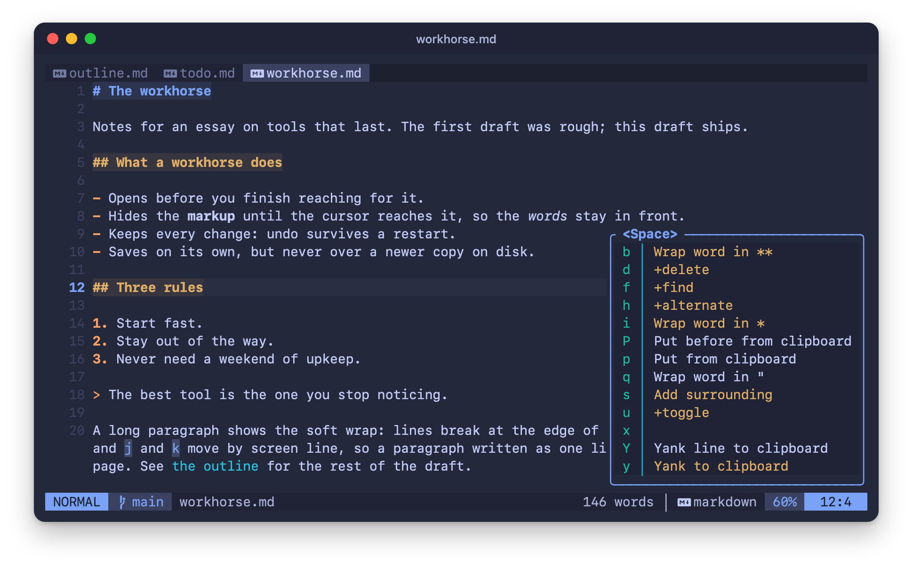

<p align="center">
  <picture>
    <source media="(prefers-color-scheme: light)" srcset="assets/logo-on-light.svg">
    
  </picture>
</p>

<h3 align="center">A stripped-down, ultra-fast Vim.<br>Install it once, then just use it.</h3>

<p align="center">
  <b>62&nbsp;ms</b>&nbsp;median&nbsp;startup &nbsp;·&nbsp; <b>19</b>&nbsp;pinned&nbsp;plugins &nbsp;·&nbsp; <b>~900</b>&nbsp;lines&nbsp;of&nbsp;Lua &nbsp;·&nbsp; <b>Neovim&nbsp;0.12</b> &nbsp;·&nbsp; <b>MIT</b>
</p>

<p align="center">
  <a href="#install">Install</a> &nbsp;·&nbsp; <a href="#what-you-get">What&nbsp;you&nbsp;get</a> &nbsp;·&nbsp; <a href="#keys">Keys</a> &nbsp;·&nbsp; <a href="#proof">Proof</a> &nbsp;·&nbsp; <a href="#what-goes-over-the-network">Network</a>
</p>

<p align="center">
  <picture>
    <source media="(max-width: 600px)" srcset="assets/screenshots/editing-phone.png">
    
  </picture>
</p>

ULVim is a stripped-down, super basic, ultra-fast version of Vim. It is not designed to be constantly modified: it is a dependable workhorse you install once and then just use.

- **Stripped down:** plain Neovim 0.12 and nineteen plugins. No language servers, no completion popup.
- **Ultra fast:** a 62 ms median start, [measured](#proof).
- **Dependable:** Neovim and every plugin pinned, and every behavior checked by [CHECKS.md](CHECKS.md).

## Install

```sh
cd ~ && git clone \
https://github.com/danielmiessler/ULVim
cd ULVim && bun scripts/install.ts
```

Then open a new shell and run `nvim`. The first launch installs the plugins and starts building the parsers.

The installer:

- checks the tree-sitter CLI,
- installs the pinned Neovim as `~/.local/bin/nvim` (the shell layer puts that folder first on PATH, and the installer checks it is there),
- links `~/.config/nvim` and `~/.config/ulvim` to the clone,
- adds two lines to the end of `~/.zshrc`: a `# ULVim shell layer` marker comment and one line that sources `shell/ulvim.zsh`.

It never replaces an existing `~/.config/nvim`; it stops and says how to move it aside. Rerunning it is safe, and `--check` reports every step without changing anything.

You can also hand the install to a coding agent: [INSTALL.md](INSTALL.md) is written for an agent to follow, with what to do for each step the installer refuses and how to roll back.

**Requirements**

- macOS on Apple silicon (Linux is not supported yet).
- `git`, `zsh`, `bun`, Homebrew, and the Xcode Command Line Tools.
- tree-sitter CLI 0.26 or newer: `brew install tree-sitter-cli`. Older ones fail every parser build silently.
- A true-color terminal with a [Nerd Font](https://www.nerdfonts.com).
- Optional: `fd`, which speeds up indexing folders that are not git repos; without it the indexer walks them itself.

## What you get

### Writing

- **Soft wrap that reads like a page.** Prose wraps on words with the indent kept, and `j` and `k` move by screen line unless you give a count.
- **Markup out of the way.** Bold and italic markers, inline-code backticks and link targets hide until the cursor reaches their line; heading marks stay. Code fence lines vanish and the code keeps its language colors.
- **Undo you can trust.** A breakpoint at every `,` `.` `;` `!` `?`, and undo history survives closing the file, except for secret files (`.env`, `*.pem`, `*.key`, `id_*`) and temp files, which keep none on disk.

<p align="center">
  
  <br>
  <sub>The command line floats mid-screen, and a substitute previews every match as you type.</sub>
</p>

- **Lists continue themselves.** Enter on a `-` or `1.` line starts the next item; an empty item ends the list.
- **Surround, text objects, pairs.** Markdown `**`, `*` and backticks as surroundings, `ig` and `ag` for the whole buffer, and pairs that leave `don't` alone.
- **Emphasis on one key** for bold, italic or quotes, and `--` types an em dash.
- **The small things.** A word count in the statusline, rendered markdown on a toggle, a focus layout, and the undo tree.

### Living next to other programs

- **Reload on change.** Files reload on focus, after a terminal, and the moment another program writes a file you have open.
- **Auto-save that keeps other programs' edits.** It saves a second after you stop editing, and at once when you leave the buffer or quit. It skips the save when the file on disk was modified in a later second than ULVim last read or wrote it, so a coding agent's edit to your open file is kept.
- **Back where you were.** Files reopen on the line you left, and saving creates missing parent folders.

### Finding things

- **A ranked file finder** on `Ctrl-Space` (and `fzp` in the shell) over the folders in `search-roots.json`. Files you opened before rank higher, fading with time.
- **oil.nvim** as the file explorer, in a float or in the window.
- **Key hints** after `Space`, `g`, `z`, `'`, `"` and `Ctrl-w`, with every leader group named.

### Look

- **tokyonight storm** on a transparent background, with blue accents and rounded borders on every float.
- **One global statusline,** buffers as tabs, and a terminal title that shows the file name.
- **The ULVim start screen** with your recent files on `1` to `6`.

<p align="center">
  
  <br>
  <sub>The start screen: find, new, quit, and your recent files one key away.</sub>
</p>

### Pinned, so it stays the same

- **The editor.** `neovim.json` pins the Neovim release and its sha256, and the installer refuses a mismatch. `bun scripts/nvim-install.ts --check` looks for a newer release; `--latest` moves the pin.
- **The plugins.** `vim.pack` installs them from the committed `nvim-pack-lock.json`. `:Lazy` opens the update review: `:write` applies, `:quit` discards.
- **The parsers.** Tree-sitter parsers for 24 languages. While any of them is missing, each start downloads and builds the missing ones in the background.

<sub>Every screenshot here is Neovim's own drawing of ULVim. <code>bun tests/capture.ts</code> starts it in a throwaway home with sample notes, attaches as a UI, feeds the keys, and renders the grid Neovim sends in the colors it sends.</sub>

## Keys

The leader is `Space`. Press it and wait to see every key below it. Keys are for normal mode unless the row says otherwise.

<p align="center">
  
</p>

| Key | Does |
|---|---|
| `jk` | leave insert mode |
| `Ctrl-s` | save (normal, insert, visual) |
| `Ctrl-Space` | ranked file finder |
| `Space f t` | file explorer in a float |
| `Shift-h` / `Shift-l` | previous / next buffer |
| `Space b` / `Space i` | bold / italic: in visual mode it wraps the selection at once; in normal mode it opens a key-hint group and `Enter` wraps the word |
| `Space u z` | focus layout |
| `ZR` | restart Neovim in place |

<details>
<summary><b>Every key</b></summary>
<br>

| Key | Does |
|---|---|
| **Moving and saving** | |
| `jk` | leave insert mode (insert, terminal) |
| `jl` | leave insert mode, save and quit (insert) |
| `Ctrl-s` | save (normal, insert, visual) |
| `Esc` | clear the search highlight |
| `ZR` | restart Neovim in place (`:restart`) |
| `Shift-h` / `Shift-l` | previous / next buffer |
| `Space b d` | close the buffer |
| `Space h a` | alternate file |
| `Cmd-z` / `Cmd-Shift-z` | undo / redo (normal, visual, insert), in terminals that pass Cmd keys; other Cmd chords type nothing |
| `q` | close the window in help, man, quickfix, the undo tree and the update review |
| **Writing** | |
| `Space b` | wrap in `**`: the selection at once (visual); the word on `Enter`, since `Space b` also opens the buffer group (normal) |
| `Space i` | wrap in `*`: the selection at once (visual); the word on `Enter`, since `Space i` also opens the image group (normal) |
| `Space q` | wrap the word or selection in `"` (normal, visual) |
| `Space s` | add a surrounding (normal, visual) |
| `Space s d` / `Space s r` | delete / replace a surrounding |
| `Space x` | toggle a checkbox, in markdown and text |
| `--` | em dash (insert) |
| `Space i i` | paste the clipboard image as a PNG in `./assets`, linked |
| **Clipboard** | |
| `Space y` / `Space Y` | yank to the system clipboard / yank the line (`Space y` also in visual) |
| `Space p` / `Space P` | put from the system clipboard, after / before (normal, visual) |
| `Space y y` | yank the whole buffer to the clipboard |
| `Space y f` | copy `path:line` to the clipboard |
| `Space d d` | delete the buffer's text and start typing |
| **Finding and toggles** | |
| `Ctrl-Space`, `Space f f` | ranked file finder |
| `Space f t` / `Space f T` | file explorer in a float / in the window |
| `Space u u` | undo tree |
| `Space u m` | rendered markdown on or off |
| `Space u z` | focus layout |

In the file explorer, `l` opens, `h` and Backspace go up, `q` closes, and `Ctrl-v` / `Ctrl-x` open in a split. Neovim's own `gO` lists a markdown file's headings.

</details>

**In the shell**

| Name | Does |
|---|---|
| `v` | `nvim` |
| `fzp`, `Ctrl-Space` at the prompt | the ranked file finder |
| `vf` / `vo` (or `vs`) / `vk` | edit the plugin list / options / keymaps |
| `vconf` | open the config folder |
| `vc` / `vd` / `vp` | cd into `lua/ulvim` / `lua` / `lua/ulvim/plugins` in the config |
| `nlp` | cd into the folder that holds the installed plugins |

It also sets `EDITOR`, `VISUAL` and `MANPAGER` to Neovim.

## Proof

[CHECKS.md](CHECKS.md) lists every check: what it looks at, what counts as a pass, and the command that measures it. Most run a real headless start of ULVim through `tests/probe.lua`, so they see what your editor sees.

```sh
bun tests/run.ts                 # every check
bun tests/run.ts ISC-12 ISC-41   # just these
bun tests/run.ts --unattended    # skip the checks whose script declares it needs a live terminal
```

The pinned-Neovim checks need the installer to have run. CI runs the checks on macOS for every push.

> **Startup:** a median of 62 ms to `NVIM STARTED` over 9 headless runs (`bun tests/startup.ts --runs 9`), measured on 2026-11-06 on the public file set in a fresh home with its plugins and parsers installed, on an Apple M2 Ultra desktop busy with other work (load average about 100). The startup check fails above 303 ms.

## What goes over the network

Plugins, tree-sitter parsers and the pinned Neovim come from GitHub. Images are fetched in two cases you can see coming, listed below, and one check asks the GitHub API for each plugin's last push. Nothing else in ULVim makes a network request, it runs no server, and it sends no telemetry.

<details>
<summary><b>Every request, in detail</b></summary>
<br>

- **Plugins.** `vim.pack` clones the nineteen plugins from GitHub on first start and fetches from GitHub when you review updates. The lockfile pins what it installs.
- **Tree-sitter parsers.** On any start while one of the 24 parsers is missing (the first start, or after a failed build), nvim-treesitter downloads that parser's source as a tarball from its GitHub repository with `curl` and builds it locally. These sources are not checksum-verified.
- **Neovim.** `bun scripts/install.ts` and `bun scripts/nvim-install.ts` download the pinned release tarball from Neovim's GitHub releases and check its sha256. `--check` and `--latest` also ask the GitHub API for the latest release.
- **Images in markdown.** In a terminal that can show images, moving the cursor onto an image link opens a preview float, and for a remote image (an `http` or `https` link) that preview downloads the image with `curl`.
- **Image paste.** With an image URL on the clipboard, `Space i i` asks that URL whether it is an image, and outside markdown files downloads it.
- **The checks.** The fresh-plugins check asks GitHub for each plugin's last push: through the `gh` CLI when it is installed and logged in, and through the public GitHub API otherwise.

</details>

## Your own layer

ULVim is meant to be used as it ships. If you need a key or two of your own, keep them out of the distribution's files so `git pull` never conflicts. Each of these loads only when it exists:

- **`lua/user/init.lua`**, required during plugin setup (the key hints and the start screen read it). It can return a table with `clues` (extra key hints), `dashboard_keys` (extra start-screen keys) and `setup()`, which runs last, after everything else. A layer that fails to load is reported and skipped, and ULVim keeps working.
- **`shell/user.zsh`**, sourced at the end of `shell/ulvim.zsh`.
- **`search-roots.local.json`**, the folders the file finder searches, used instead of `search-roots.json`.

## Credits

ULVim is a thin layer over other people's work. Thank you to [Neovim](https://github.com/neovim/neovim) and to the authors of every plugin it runs:

| Plugin | Used for |
|---|---|
| **Look** | |
| [tokyonight.nvim](https://github.com/folke/tokyonight.nvim) by [folke](https://github.com/folke) | colors |
| [snacks.nvim](https://github.com/folke/snacks.nvim) by [folke](https://github.com/folke) | start screen, picker engine, input, image float |
| [lualine.nvim](https://github.com/nvim-lualine/lualine.nvim) by [nvim-lualine](https://github.com/nvim-lualine) | statusline |
| [tiny-cmdline.nvim](https://github.com/rachartier/tiny-cmdline.nvim) by [rachartier](https://github.com/rachartier) | floating command line |
| [mini.icons](https://github.com/nvim-mini/mini.icons), [mini.tabline](https://github.com/nvim-mini/mini.tabline), [mini.clue](https://github.com/nvim-mini/mini.clue) by [nvim-mini](https://github.com/nvim-mini) | file icons, buffer tabs, key hints |
| **Editing** | |
| [mini.surround](https://github.com/nvim-mini/mini.surround), [mini.ai](https://github.com/nvim-mini/mini.ai) by [nvim-mini](https://github.com/nvim-mini) | surroundings, text objects |
| [nvim-autopairs](https://github.com/windwp/nvim-autopairs) by [windwp](https://github.com/windwp) | pairs |
| [auto-save.nvim](https://github.com/okuuva/auto-save.nvim) by [okuuva](https://github.com/okuuva) | auto-save |
| [bullets.vim](https://github.com/bullets-vim/bullets.vim) by [bullets-vim](https://github.com/bullets-vim) | list continuation, checkboxes |
| [vim-repeat](https://github.com/tpope/vim-repeat) by [tpope](https://github.com/tpope) | `.` for plugin maps |
| [vim-visualrepeat](https://github.com/inkarkat/vim-visualrepeat) by [inkarkat](https://github.com/inkarkat) | `.` in visual mode |
| **Markdown and files** | |
| [render-markdown.nvim](https://github.com/MeanderingProgrammer/render-markdown.nvim) by [MeanderingProgrammer](https://github.com/MeanderingProgrammer) | rendered markdown |
| [no-neck-pain.nvim](https://github.com/shortcuts/no-neck-pain.nvim) by [shortcuts](https://github.com/shortcuts) | focus layout |
| [oil.nvim](https://github.com/stevearc/oil.nvim) by [stevearc](https://github.com/stevearc) | file explorer |
| [img-clip.nvim](https://github.com/HakonHarnes/img-clip.nvim) by [HakonHarnes](https://github.com/HakonHarnes) | image paste |
| [nvim-treesitter](https://github.com/nvim-treesitter/nvim-treesitter) by [nvim-treesitter](https://github.com/nvim-treesitter) | parsers and queries |

## License

[MIT](LICENSE). Made by Daniel Miessler.
